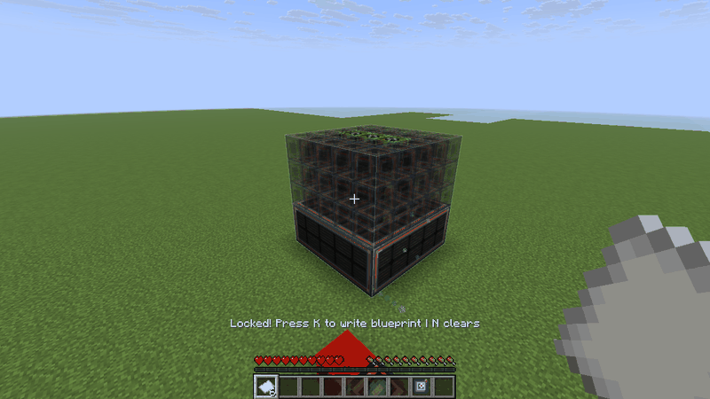
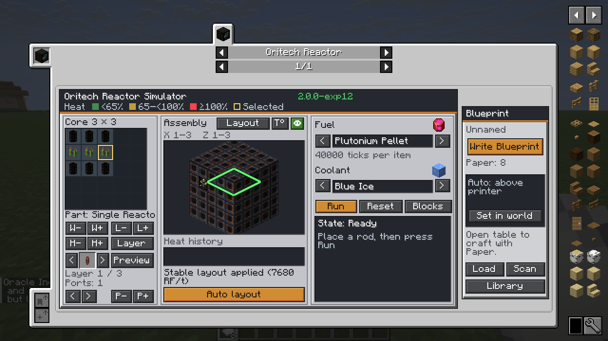
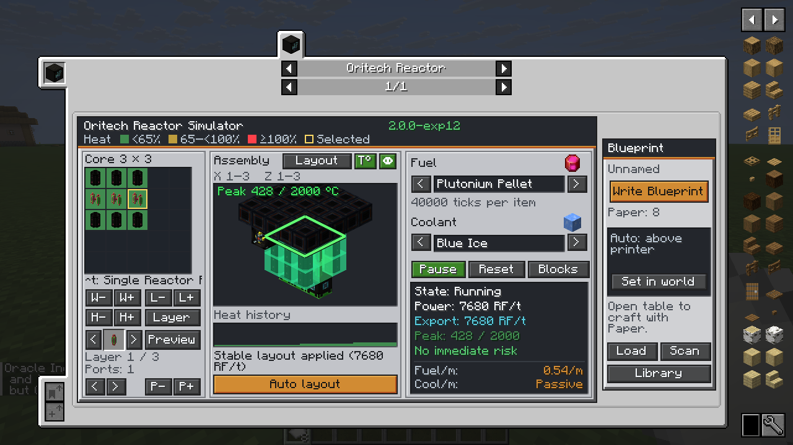
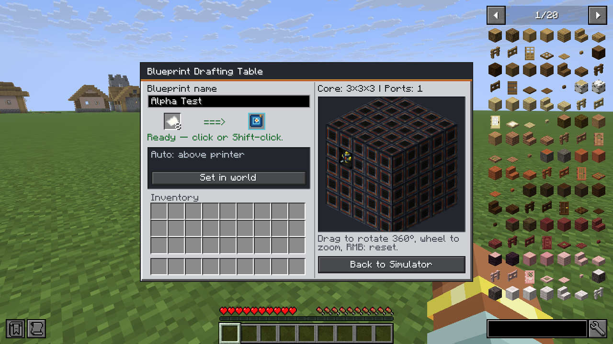
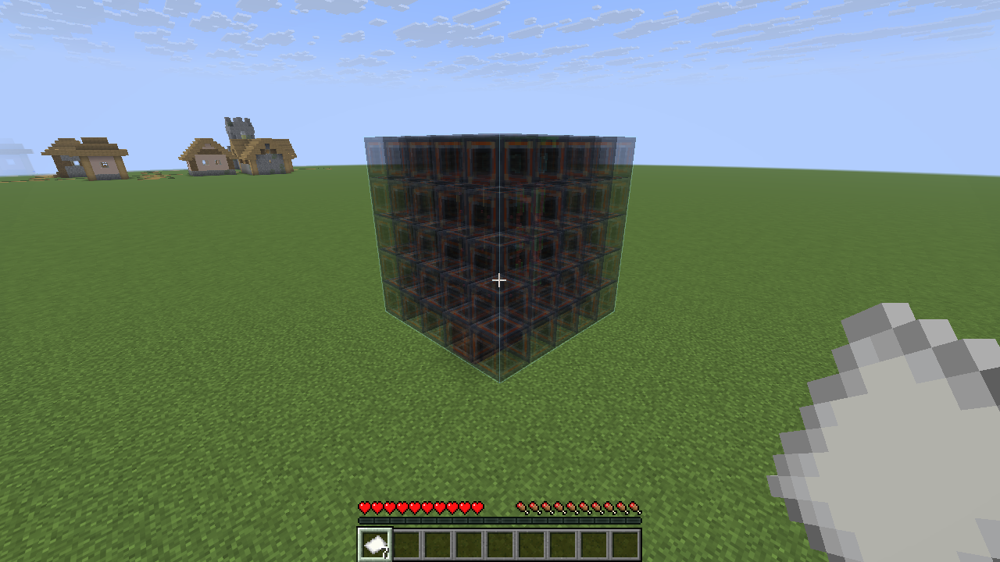
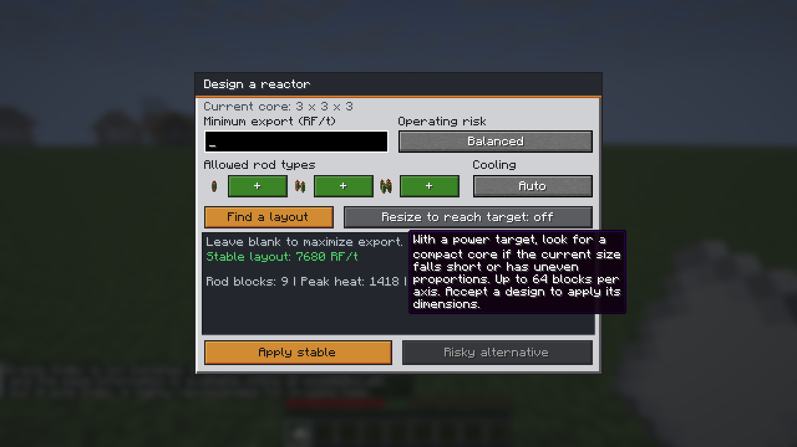
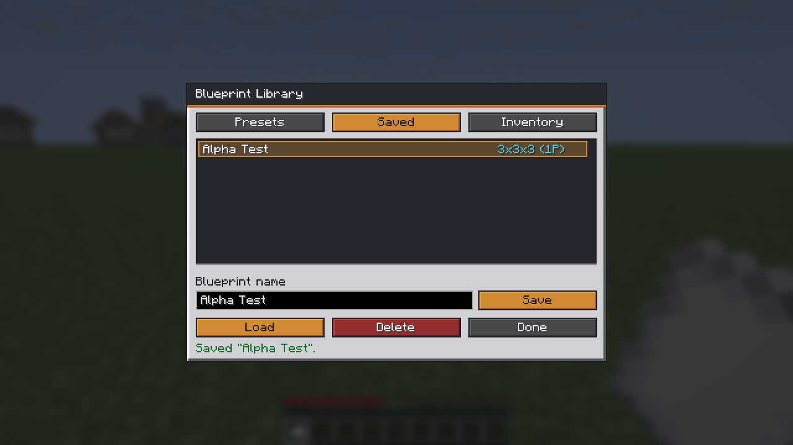
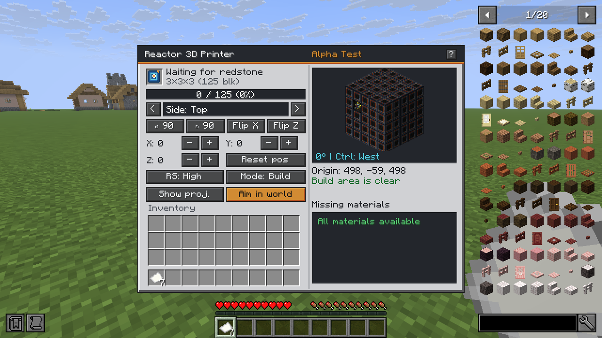
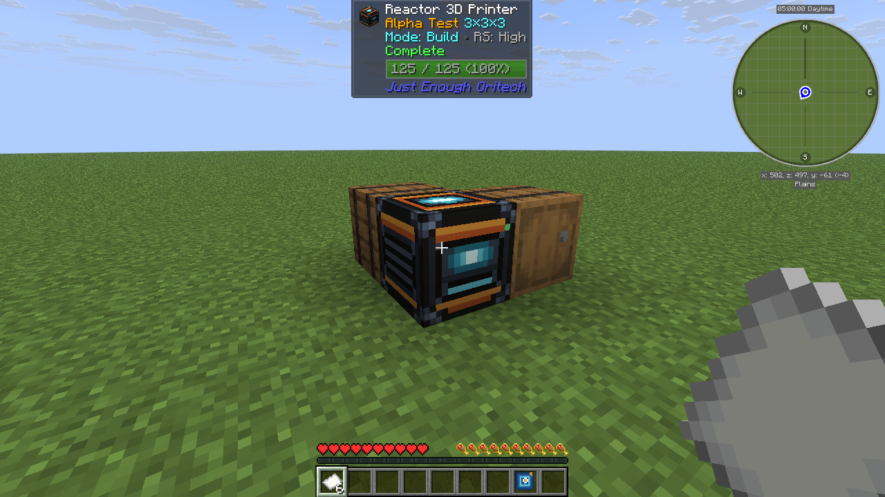

# Just Enough Oritech

JEI multiblock reactor planner, live 3D thermal simulator, and autonomous 3D Printer for **Oritech** (Minecraft **26.1.2** / NeoForge).

Created by **NiceClown**. See the [Changelog](CHANGELOG.md) for full release notes and [GitHub Issues](https://github.com/NiceClown/JustEnoughOritech/issues) for bug reports.

  
  

## Highlights in 1.0.0

- **Real Oritech Translucent Ghost Blocks in World**: builds up to `4,096` blocks project actual translucent Oritech block models in-world (hiding already-placed blocks and highlighting obstructions in red), switching to color wireframes and outer prisms for massive reactors up to `256×256×256`.
- **Blueprint Drafting Table with Full Inventory**: click **Write Blueprint** in JEI to open a dedicated container screen showing your 36-slot inventory, custom blueprint naming box, world-anchor button, real **Paper** input slot, and **Reactor Blueprint** output slot.
- **360° Trackball Orbit, Scroll Zoom & Live 3D Heatmap (`T°`)**: freely orbit (`LMB` drag), zoom (`0.4×–4.0×` mouse wheel), and reset (`RMB`) all 3D previews. Click **`T°`** to auto-start simulation, hide casing walls, and inspect core heat with glowing gradient overlays.
- **Warcraft-3 Box Placement & Part Icon Selector**: click or scroll the active block icon between `<` and `>`, and drag **LMB** (green marquee) or **RMB** (red marquee) on the 5×5 core grid to fill or clear rectangles at once.
- **Autonomous, Fast Chunk-Loaded Reactor 3D Printer**:
  - Works in **any loaded chunk** without requiring the owner within 32 blocks (uses adjacent chests/barrels first and respects land claims via the owner's `FakePlayer` UUID; online Creative mode & inventory fallback work at any distance in the same dimension).
  - Scales build and dismantle speed linearly from `1 block/tick` up to **`512 blocks/tick`** — a maximum vanilla `66×66×66` reactor (`287,496` blocks) builds at `80 blocks/tick` (**under 3 minutes**).
  - Supports 3 redstone modes (`RS: High` / `RS: Low` / `RS: On`), reverse **Dismantle** mode, `0..15` comparator progress signal, clickable JEI recipe lookups for missing items, and optional **Jade** HUD tooltips.
- **Mega-Reactors (`256×256×256`)**: internal limits in JEO reach `256` per interior axis (`100M+ RF/t`). *(Note: Oritech's own server config `config/oritech-common.toml` defaults `maxSize = 66` (`64` interior) and `reactorMaxEnergyOutput = 25000`; raise `maxSize` on your server to assemble reactors larger than `66×66×66` in-world.)*

## Supported Environment

- **Minecraft**: `26.1.2`
- **NeoForge**: `26.1.2.109+` (verified up to `26.1.2.126`)
- **Java**: `25`
- **JEI**: `29.53.0.115`
- **Oritech**: `2.0.0-exp12` & `2.0.0-exp14` (tested in Standalone, **ATM11** with 301 mods, and **FTB Evolution 2** with 437 mods)
- **Optional**: **Jade** (`26.1.12+`) for in-world 3D Printer HUD details

Install **Just Enough Oritech** on both client and server. At login and datapack reload, the server synchronizes Oritech's active reactor config, fuel recipes, and coolant tags cleanly.

## Screenshots

| JEI Reactor Simulator | 3D Thermal Heatmap (`T°`) |
| :---: | :---: |
|  |  |

| Blueprint Drafting Table | Translucent Oritech Ghosts in World |
| :---: | :---: |
|  |  |

| Auto Layout Designer | Blueprint Library (Presets & Saved) |
| :---: | :---: |
|  |  |

| Reactor 3D Printer GUI | 16×16 Printer & Jade HUD (ATM11) |
| :---: | :---: |
|  |  |

## Controls & Workflow

1. **Open Simulator**: press **`K`** (configurable) or view recipes/uses of the Nuclear Reactor Controller in JEI.
2. **Design Core**: click or drag `LMB`/`RMB` on the 5×5 grid to batch-place/clear parts, scroll (`Shift + scroll`) to pan large cores, use **`T°`** for 3D thermal analysis, or open **Auto layout** / **Library** (4 verified stable presets + personal saves in `config/just_enough_oritech/blueprints.json`, plus **Scan** or `Shift + RMB` on a built Nuclear Reactor Controller).
3. **Write a Blueprint**: click **Write Blueprint** to open the **Blueprint Drafting Table**, name your design, optionally lock a world position (**Set in world**, `R` to rotate, `Y` to lock, `N` to cancel), place **Paper** in the left slot, and take the **Reactor Blueprint**.
4. **Automate with the Reactor 3D Printer**:
   - Crafted from `#c:ingots/steel`, motors, a tier-three machine core, processing unit, and dispenser.
   - Insert your **Reactor Blueprint** (auto-anchors above the **Top** face if unanchored, or uses the embedded world coordinates), adjust **Attach Side**, **Rotation / Flip**, **Offsets** (`±1` / `Shift ±10` / `Ctrl ±50`), **Redstone** (`High` / `Low` / `Always On`), or toggle **Build / Dismantle**.
   - Click **Show proj.** at any time without closing the printer UI to inspect translucent ghosts in-world.
   - Supply blocks in adjacent chests/barrels/storage and power redstone — the printer works in any loaded chunk even when you leave the area.

## Languages

Full **English** (`en_us`) and **Russian** (`ru_ru`) interfaces included.

## Build from Source

Run `./gradlew build` (`.\gradlew.bat build` on Windows) with Java 25. Output is written to `build/libs/`.
